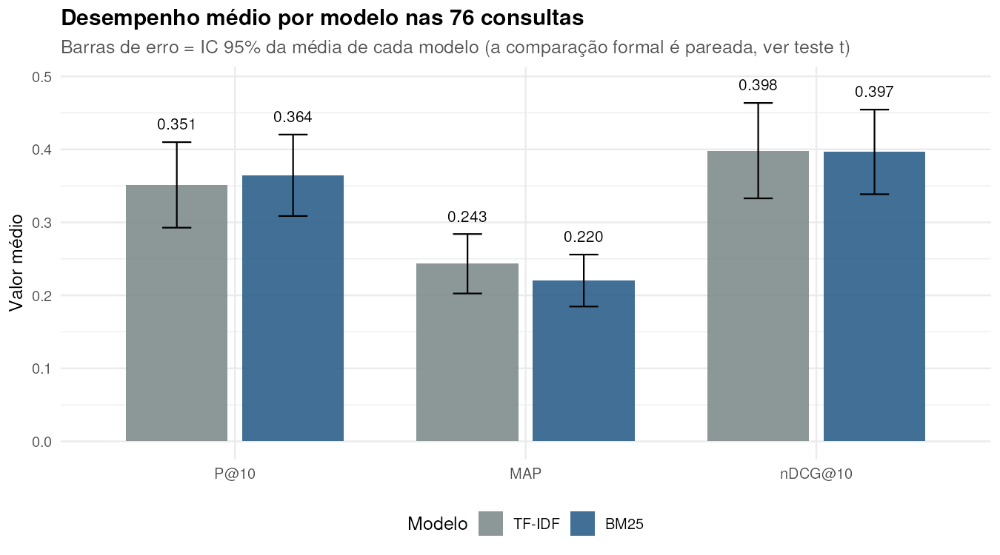
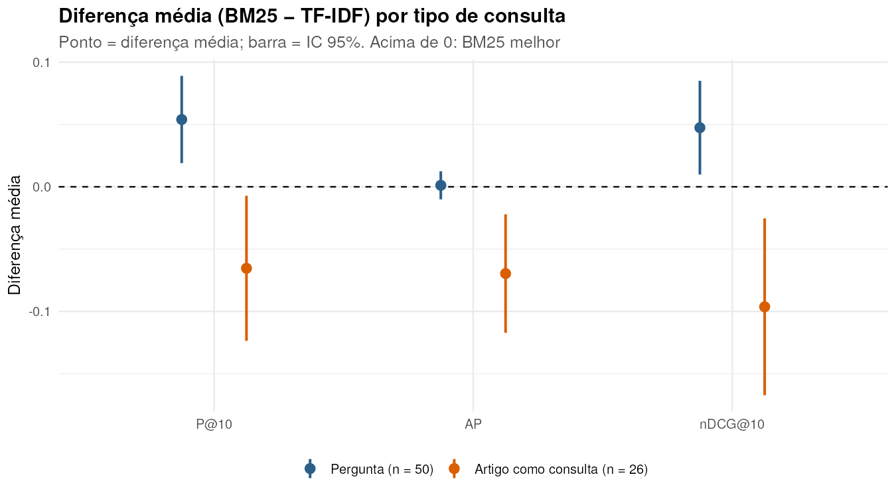
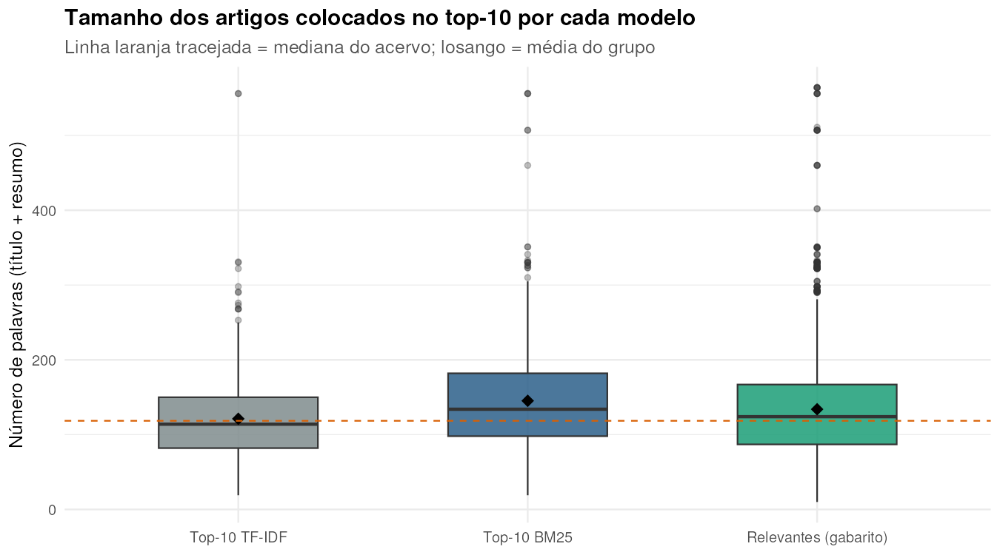

# Conclusão: a biblioteca deve trocar o TF-IDF pelo BM25?

**Não.** Nas 76 consultas da coleção CISI, o BM25 não colocou os artigos relevantes significativamente mais perto do topo do que o TF-IDF. A análise completa está nas seções 5 e 6 do [notebook](../notebooks/analise.ipynb).

## Resultado principal

Teste t pareado unilateral (H₁: BM25 melhor), α = 0,05, nas 76 consultas com gabarito:

| Métrica | TF-IDF | BM25 | Diferença média (BM25 − TF-IDF) | p (unilateral) | Decisão |
| --- | --- | --- | --- | --- | --- |
| P@10 | 0,351 | 0,364 | +0,013 | 0,21 | Não rejeita H₀ |
| MAP | 0,243 | 0,220 | −0,023 | 0,99 | Não rejeita H₀ |
| nDCG@10 | 0,398 | 0,397 | −0,002 | 0,54 | Não rejeita H₀ |

- Em nenhuma métrica o BM25 foi significativamente melhor. No MAP, ele ficou abaixo do TF-IDF (IC 95% da diferença: [−0,042; −0,004]), mas o teste de Wilcoxon, que não depende de normalidade, não confirma essa piora (p bilateral = 0,22).
- O teste de Wilcoxon pareado chega à mesma conclusão que o teste t nas três métricas.

## O que explica o resultado

**O tipo de consulta (análise exploratória).** O BM25 ganha nas perguntas curtas e perde nas consultas longas, e os dois efeitos se cancelam na média:

| Tipo de consulta | n | Diferença no P@10 | Diferença no MAP | Diferença no nDCG@10 |
| --- | --- | --- | --- | --- |
| Pergunta (mediana de 18,5 palavras) | 50 | **+0,054** (p = 0,003) | +0,001 (p = 0,83) | **+0,047** (p = 0,015) |
| Artigo como consulta (mediana de 102 palavras) | 26 | **−0,065** (p = 0,029) | **−0,070** (p = 0,006) | **−0,096** (p = 0,010) |

**O viés de tamanho.** O tamanho do artigo não está associado à relevância (teste de Mann-Whitney, p = 0,97). Mesmo assim, o TF-IDF coloca no top-10 artigos mais curtos (média de 121 palavras) e o BM25, mais longos (145 palavras) do que os artigos relevantes (134 palavras).

## Recomendações

1. **Não trocar o sistema inteiro agora.** Não há evidência de melhora para o conjunto dos usuários.
2. **Fazer um piloto do BM25 só na busca por palavras-chave** (consultas curtas), mantendo o TF-IDF na função "artigos semelhantes a este". Avaliar o piloto com consultas novas antes de decidir, porque a análise por tipo foi exploratória.

## Arquivos desta pasta

| Pasta | Conteúdo |
| --- | --- |
| [`tf-idf/`](tf-idf/) | Métricas por consulta, top-10 de cada consulta e distribuição das métricas do TF-IDF |
| [`bm25/`](bm25/) | O mesmo para o BM25 |
| [`comparison/`](comparison/) | Médias, testes estatísticos, normalidade das diferenças, placar por consulta, análise por tipo de consulta e tamanho dos artigos no top-10 |
